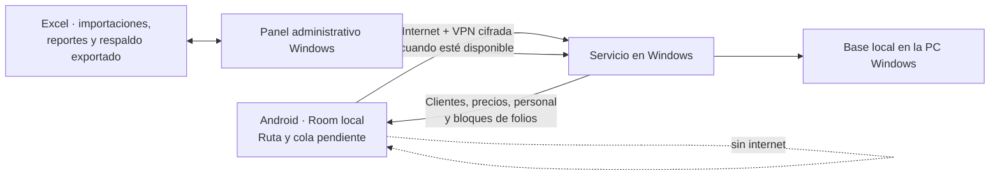

# Arquitectura acordada: Windows administrativo y Android de ruta

## Decisiones que definiste

- Windows lo usa el dueño y permanece conectado a internet.
- Android lo usan vendedores, choferes y ayudantes. Sincroniza por internet cuando puede y sigue operando si no hay conexión.
- No se usa una base de datos externa o de nube. Los datos centrales viven en la PC Windows; cada teléfono conserva su copia de trabajo.
- Windows administra las cuentas, autoriza personas y teléfonos, publica datos y supervisa lo que Android envía.
- Android tendrá una pantalla sencilla para asignar a cada ruta los nombres y puestos de vendedor, chofer y ayudante. No asignará clientes a días ni filtrará el catálogo por día.
- Windows asigna automáticamente folios únicos a cada dispositivo Android.
- Windows mantiene un catálogo oficial de clientes y lo sincroniza completo a todos los teléfonos autorizados. Todos tendrán los mismos clientes; quién visita a cada uno puede variar cada día.

## Conexión y operación sin internet

Windows ejecuta el servicio de sincronización y guarda la base central en la computadora del negocio. La pantalla de Windows y el servicio usan esos mismos datos. Android guarda su trabajo en una base local del teléfono.

Cuando hay internet, Android se conecta al servicio de Windows por un enlace privado cifrado. Para permitir conexión desde fuera del negocio sin abrir públicamente el puerto de la PC, recomiendo una VPN privada entre la computadora y los teléfonos. El servicio de coordinación de la VPN no guarda ventas ni clientes: solo permite que los equipos se encuentren. WireGuard es otra opción, con más configuración técnica.

Cuando Android pierde internet, las ventas, pagos, abonos, firmas y asignación de ruta quedan guardados en el teléfono. La app marca los movimientos como pendientes y los envía cuando vuelve la conexión. Si Windows no responde, Android conserva la cola y reintenta después.

## Excel y almacenamiento seguro

No recomiendo usar un archivo Excel abierto como base de datos compartida para la operación diaria. Si varios teléfonos sincronizan a la vez, una hoja no ofrece el control de transacciones necesario para evitar sobrescrituras, duplicados o saldos parciales.

Esto no requiere una base de datos en la nube. La propuesta es guardar la información en SQLite local en la PC Windows y Room (SQLite) en cada Android. Excel queda disponible para importar clientes y precios, exportar reportes y generar copias legibles. Los datos centrales siguen en tu computadora y pueden respaldarse también en archivos Excel, sin depender de una base externa.

El servicio de Windows debe iniciar junto con la PC, funcionar aunque el dueño cierre la pantalla y crear respaldos automáticos locales. La carpeta de datos no se comparte directamente por red; los teléfonos solo usan la API autenticada.

## Flujo de personal y rutas

1. **El dueño crea y autoriza cuentas en Windows.** Vendedor es una cuenta de acceso. En Android se asignan los nombres y puestos del vendedor, chofer y ayudante de cada ruta.
2. **El teléfono se vincula.** Android inicia sesión, presenta su solicitud de dispositivo y Windows la muestra para aprobación. La app tendrá una credencial privada por instalación; la MAC por sí sola no autentica el teléfono.
3. **El equipo prepara la ruta en Android.** En “Asignar personal de ruta” registra los nombres y puestos de vendedor, chofer y ayudante. El vendedor debe coincidir con la cuenta iniciada. No se asignan días de entrega a clientes. El teléfono descarga el catálogo completo, precios, productos, reglas de crédito y folios.
4. **El teléfono trabaja sin conexión.** Las entregas conservan las reglas actuales de Android: modalidades, pesos, marcas, precio por producto, azúcar, contado/crédito, pagos y firma. Cada movimiento recibe un ID local único y conserva su orden.
5. **Android sincroniza cuando puede.** Sube pendientes y recibe cambios de clientes/precios. Reenviar un movimiento no lo duplica. Sin internet, sigue trabajando y conserva la cola.
6. **Windows supervisa los movimientos.** El panel muestra dispositivo y ruta de origen. Los movimientos recibidos quedan visibles para revisión del dueño. Windows los acepta, rechaza con motivo o pide corrección; conserva el historial original.
7. **El dueño administra el catálogo.** Windows envía la lista completa de clientes a todos los teléfonos autorizados. Android guarda esa copia para trabajar sin conexión. No se asignan días fijos por cliente. Un cliente nuevo capturado en ruta queda provisional hasta que Windows lo revise.

La cuenta iniciada determina quién es el vendedor; el nombre no se acepta como sustituto de la sesión. Chofer, ayudante, dispositivo y ruta quedan como datos de auditoría. Todos los teléfonos autorizados descargan el mismo catálogo de clientes.

## Inicio de sesión y permisos

Para empezar recomiendo cuentas administradas por Windows: el dueño crea el usuario, asigna su perfil y entrega usuario/correo y contraseña. Android usa esas credenciales para el primer acceso y conserva una sesión segura para permitir el trabajo offline. Si el dueño bloquea una cuenta, el cambio llega al teléfono al reconectarse. Google Sign-In se puede agregar después, pero no es necesario y añade configuración y dependencia de un proveedor de identidad.

Windows conserva permisos de dueño: autorizar cuentas y dispositivos, revisar sincronizaciones, corregir o cancelar registros con historial, y administrar clientes y precios. Android tendrá las funciones de ruta acordadas —entregas, marcas y precios, crédito, pagos, abonos, asignación del personal, mermas e incidentes— con permisos de vendedor. No tendrá acciones administrativas de dueño; los movimientos que requieran revisión quedarán pendientes para Windows.

## Folios automáticos sin duplicados

La dirección MAC no es buena llave para folios ni para autorizar teléfonos: Android puede usar direcciones aleatorias, la MAC puede cambiar y se puede copiar. En su lugar, cada instalación genera un identificador aleatorio propio y Windows la vincula a una credencial aprobada.

Windows mantiene un contador central y entrega a cada teléfono bloques exclusivos de folios antes de que salga a ruta. Guarda qué rango pertenece a qué cuenta, equipo y ruta. Android consume esos folios localmente sin internet; Windows nunca entrega el mismo número a otro teléfono. Al sincronizar, valida que cada folio pertenezca al bloque asignado y lo marca como usado.

Los bloques se solicitan automáticamente cuando el teléfono tiene internet y quedan guardados para la siguiente ruta. Si un teléfono agota su bloque sin internet, puede guardar el movimiento con un ID temporal interno, pero no imprimirlo como folio oficial: recibirá el folio de Windows al sincronizar. Los folios no usados se registran como anulados o se concilian; no se reciclan silenciosamente.

## Autoridad de Windows y modo offline

Para que Android trabaje sin internet, Windows no puede aprobar cada toque antes de guardar una venta. La separación será:

- **Antes de salir:** Windows autoriza usuario y dispositivo, y entrega clientes, precios, permisos y folios.
- **Durante la ruta:** Android guarda movimientos localmente usando la última información sincronizada. Cada registro queda como local/pendiente.
- **Después de sincronizar:** Windows revisa los movimientos. Solo los aceptados afectan el registro administrativo oficial y sus reportes. Los rechazados permanecen en el historial con su razón y requieren corrección supervisada.

Si el dueño cambia un precio o bloquea un usuario mientras Android está desconectado, el teléfono conocerá ese cambio al reconectarse. Puede terminar la ruta con los datos y autorización que ya tenía; Windows mostrará cuándo fue su última sincronización.

## Una sola lógica de negocio

Android ya tiene cálculos más completos para sus entregas. Windows debe adoptar esas reglas y conservar los datos originales: detalle por producto, peso bruto/tara/neto, modalidad, marca, precio aplicado, azúcar, contado/crédito, pagos y firma. Windows recalcula al recibir y compara el resultado con el importe enviado; no cambia silenciosamente el importe del ticket.

Android será la app de ruta y personal; Windows conserva las funciones administrativas del dueño. Windows no necesita replicar pantallas de captura de ruta si permite revisar, corregir con trazabilidad, cancelar y reportar los datos recibidos.

## Estado real del código y trabajo pendiente

- Android ya usa Room local, pero la variante Directo de Granja todavía no tiene acceso de vendedor, pantalla de ruta ni sincronización real.
- Windows ya tiene API y autorización inicial de dispositivos, y el primer bloque de entrega acepta varias líneas/precios, azúcar y contado/crédito. Todavía guarda el estado en JSON, no en SQLite.
- Faltan el mapeo de clientes, folios reservados por dispositivo, confirmación individual de movimientos, pagos/abonos, firmas y aprobación/rechazo desde Windows.
- El teléfono necesita credencial por instalación y cifrado del enlace antes de usarse con datos reales. La MAC no resuelve esto.

## Orden de implementación

1. Cambiar Windows de almacenamiento JSON a SQLite local y hacer que su servicio arranque con la computadora.
2. Completar cuentas, personal, vinculación de dispositivos y revisión de registros en Windows.
3. Implementar el asignador central de bloques de folios por dispositivo.
4. Añadir a Android el inicio de sesión, la pantalla de preparación de ruta, la cola offline y sincronización con reintentos.
5. Alinear clientes, entregas, pagos, abonos, firmas y cierres; hacer cada envío idempotente.
6. Probar con cuentas y ventas ficticias, incluyendo dos teléfonos offline, desconexiones, reintentos, folios agotados y restauración de respaldo.
7. Activar el uso real después de confirmar que Windows concilia todos los movimientos recibidos.

La propuesta mantiene los datos en tus equipos, permite que Android trabaje sin internet y deja Windows como autoridad administrativa. Excel se conserva para importar, reportar y respaldar, no como archivo simultáneo de trabajo.

## Inventario de bodega y reportes de ruta

La variante Directo de Granja en Android no mostrará Compras ni Inventario, y no capturará compras. Windows es el único origen del inventario de bodega. Las entregas de Android descuentan/reservan existencias de bodega al sincronizarse; si quedan rechazadas, Windows restaura esas existencias al recalcular. Las mermas e incidentes sí se capturan en una pantalla de Android y se sincronizan para revisión en Windows; no se convierten automáticamente en descuentos de inventario hasta que el dueño defina y apruebe el ajuste.
